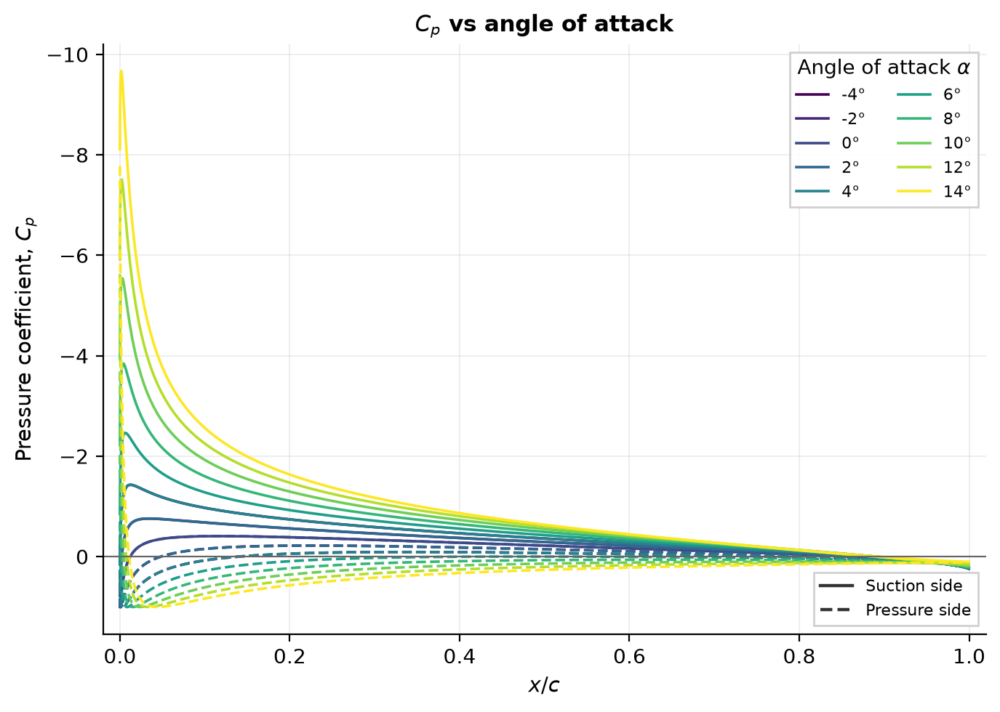
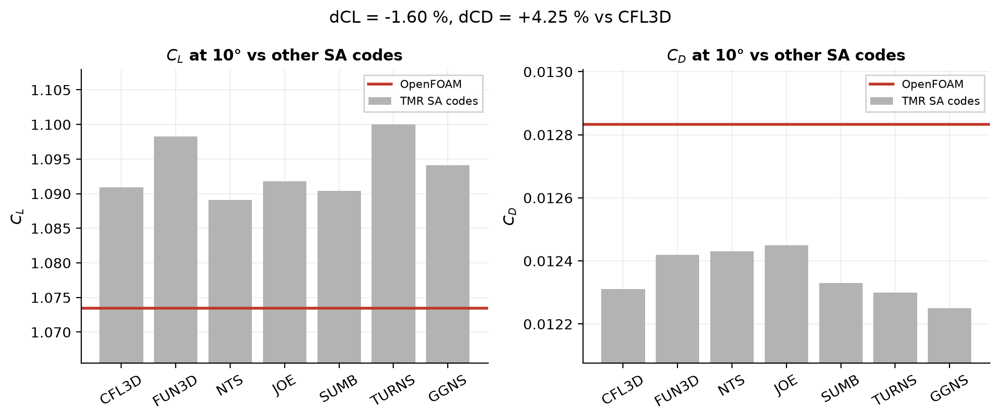
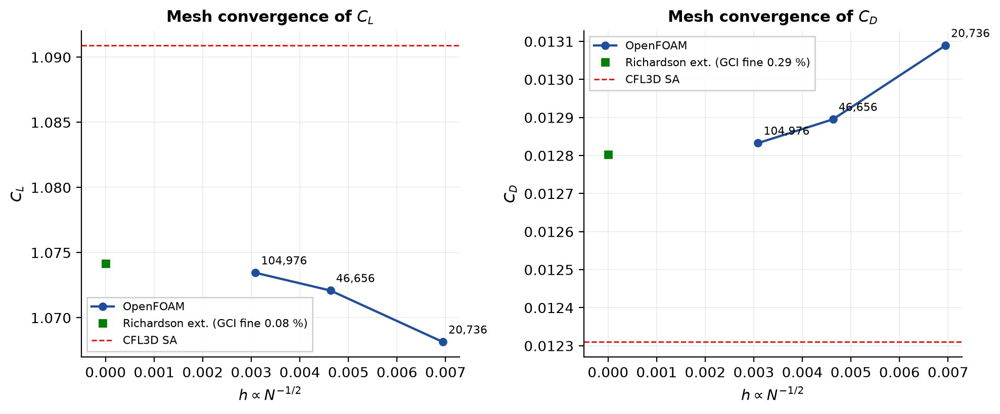
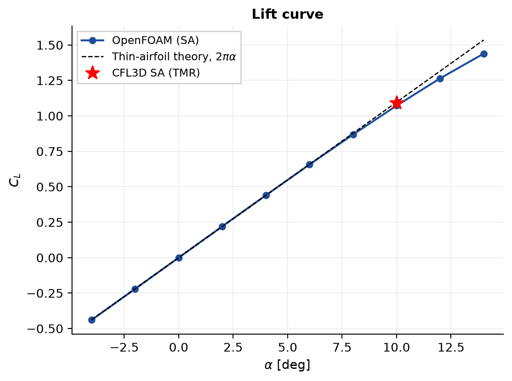
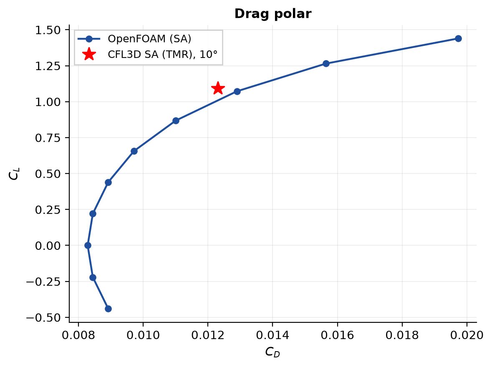
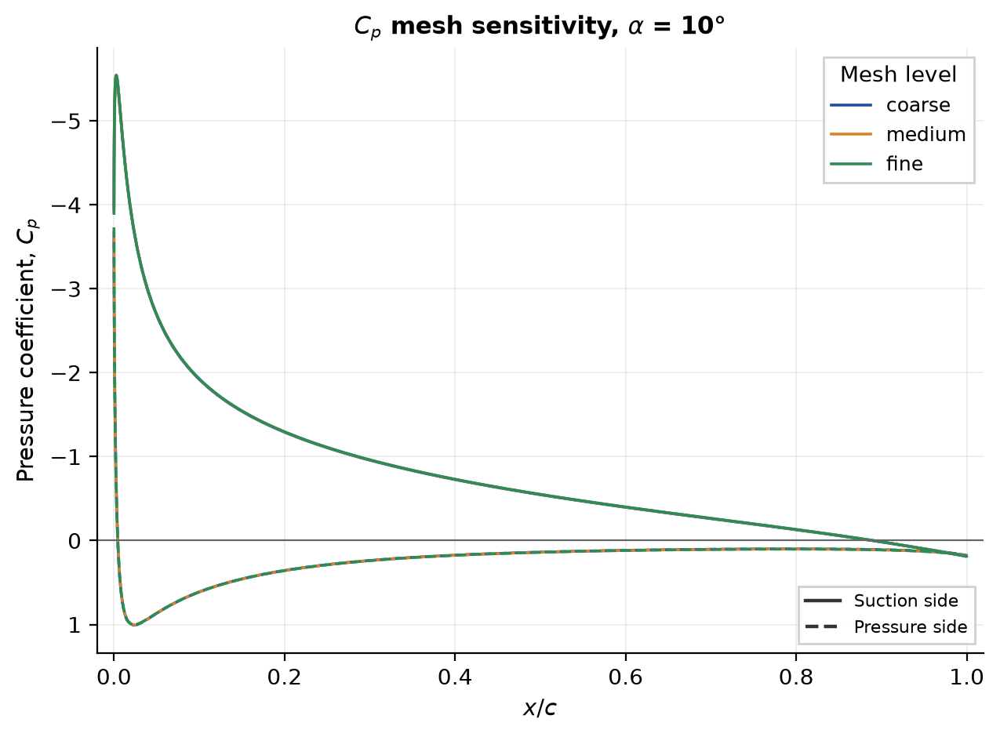
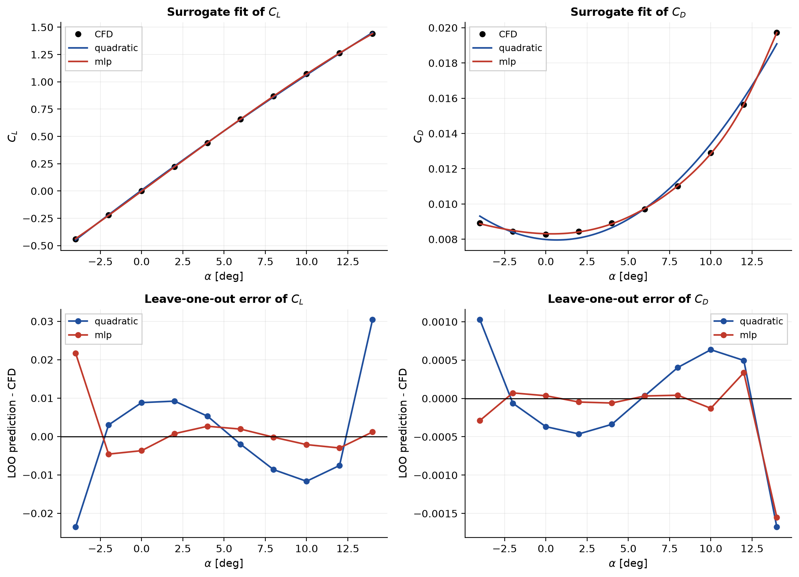
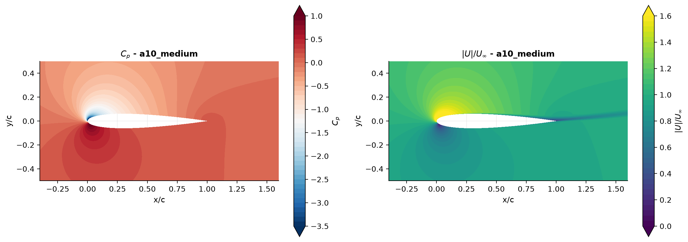
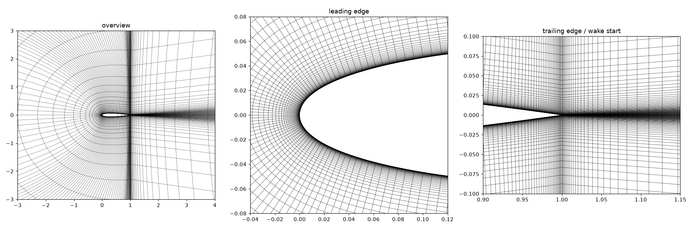
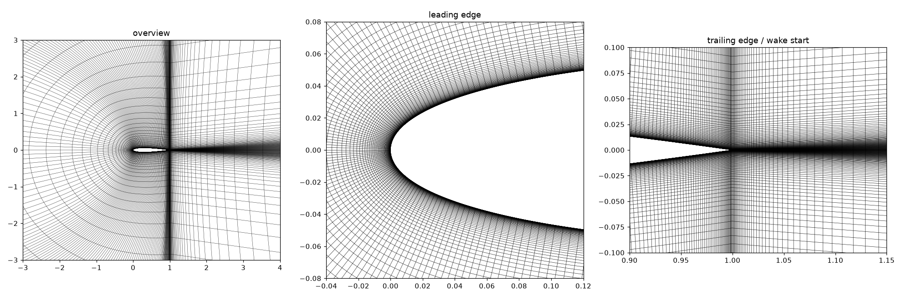

# NACA 0012 – OpenFOAM Validation and ML Surrogate

A fully scripted, open-source CFD workflow for the NACA 0012 airfoil at Re = 6·10⁶:

* structured C-mesh generator (three refinement levels),
* Spalart–Allmaras RANS setup in OpenFOAM (`simpleFoam`),
* validation against the NASA Turbulence Modeling Resource (TMR) NACA 0012 case,
* mesh-convergence study with Grid Convergence Index (GCI),
* angle-of-attack sweep (α = −4° … 14°),
* a small ML surrogate (MLP) benchmarked against a quadratic response surface.

<p align="center">
  
</p>

## Contents

1. [Results summary](#results-summary)
2. [Quick start](#quick-start)
3. [Numerical setup](#numerical-setup)
4. [Figures](#figures)
5. [Repository layout](#repository-layout)
6. [Limitations](#limitations)
7. [References](#references)

## Results summary

Free-stream Re = 6·10⁶, fully turbulent Spalart–Allmaras, α = 10°. Reference: TMR CFL3D SA result
(C<sub>L</sub> = 1.0909, C<sub>D</sub> = 0.01231).

| Mesh | Cells | C<sub>L</sub> | C<sub>D</sub> | y⁺ max | ΔC<sub>L</sub> vs CFL3D | ΔC<sub>D</sub> vs CFL3D |
|---|---:|---:|---:|---:|---:|---:|
| Coarse | 20,736 | 1.0681 | 0.013089 | 3.91 | −2.09 % | +6.33 % |
| Medium | 46,656 | 1.0721 | 0.012895 | 2.41 | −1.72 % | +4.75 % |
| Fine | 104,976 | 1.0735 | 0.012833 | 1.53 | −1.60 % | +4.25 % |
| Richardson extrapolation | – | 1.0742 | 0.012803 | – | – | – |

| Quantity | Value |
|---|---|
| GCI (fine mesh), C<sub>L</sub> | 0.08 % (observed order p ≈ 2.6, monotonic) |
| GCI (fine mesh), C<sub>D</sub> | 0.29 % (observed order p ≈ 2.8, monotonic) |
| Surrogate, held-out MAE(C<sub>L</sub>) | 0.0016 (MLP) vs 0.0056 (quadratic) |
| Surrogate, held-out MAE(C<sub>D</sub>) | 4.1·10⁻⁵ (MLP) vs 3.0·10⁻⁴ (quadratic) |
| Surrogate evaluation time | ≈ 0.2–0.4 ms per call (≳ 5·10⁵ × faster than a CFD run) |

### Deviation from the TMR reference

<p align="center">
  
</p>

*Fine-mesh C<sub>L</sub> and C<sub>D</sub> (red line) against the seven SA codes in the TMR (grey bars).*

### Mesh convergence and GCI

<p align="center">
  
</p>

*C<sub>L</sub> and C<sub>D</sub> versus characteristic cell size h ∝ N<sup>−1/2</sup>, with the Richardson-extrapolated
value and the fine-mesh GCI.*

Notes:

* The solution is mesh-converged (GCI < 0.3 %), but the fine-mesh C<sub>L</sub> sits about 1.6 % below and C<sub>D</sub>
  about 4 % above CFL3D, i.e. outside the spread of the seven TMR codes. Plausible causes are the incompressible
  formulation (TMR uses M = 0.15) and the one-cell-thick domain; neither has been isolated yet.
* The surrogate uses 10 CFD points (8 train / 2 test); the leave-one-out errors in
  `results/surrogate_metrics.json` are the more reliable accuracy indicator.

### Aerodynamic coefficients and flow field

<p align="center">
  
  
</p>

<p align="center">
  
  
</p>

<p align="center">
  
</p>

*Top: lift curve and drag polar from the α sweep. Middle: C<sub>p</sub> is independent of the mesh level at
α = 10° (left); surrogate fit and leave-one-out error (right). Bottom: C<sub>p</sub> and velocity-magnitude contours,
α = 10°, medium mesh.*

## Quick start

You need Python 3 (developed with 3.14) and, for the CFD runs, OpenFOAM (ESI v2312 was used here). The meshes, the
tests and the plotting need only Python.

```bash
# 1. set up Python
python3 -m venv .venv && source .venv/bin/activate
pip install -r requirements.txt

# 2. check the install and build the meshes (no OpenFOAM needed)
pytest tests
python mesh/make_mesh.py --level all --plot        # coarse / medium / fine -> mesh/

# 3. run one case and validate it (OpenFOAM needed)
source /usr/lib/openfoam/openfoam2312/etc/bashrc   # adjust to your installation
python scripts/run_case.py runs/a10_medium --alpha 10 --level medium --n-iter 3000
python scripts/validate.py runs/a10_medium/results.json
python scripts/plot_cp.py runs/a10_medium          # single Cp plot

# 4. reproduce the full study (each step uses the results of the previous one)
python scripts/mesh_study.py --run                 # coarse/medium/fine at 10 deg -> GCI
python scripts/sweep.py                            # alpha = -4..14 deg -> results/sweep.csv
python ml/train_surrogate.py                       # MLP vs quadratic surrogate

# 5. figures and video
python scripts/make_plots.py                       # all figures -> results/figures/
python scripts/make_video.py                       # alpha-sweep video -> results/videos/
```

Run all commands from the repository root. The solved cases go into `runs/` (about 0.5 GB, not
tracked by git). `results/figures/` only keeps the headline figures; `make_plots.py` rebuilds
the full set from `runs/`.

`case/` is a pre-rendered baseline (α = 10°, Re = 6·10⁶, medium mesh): `cd case && ./Allrun`.

## Meshes

Three structured C-meshes from `mesh/make_mesh.py`, refined by about 1.5× in each direction.
Each plot shows the whole domain around the airfoil, the leading edge and the trailing edge / wake start.

**Coarse – 20,736 cells**


**Medium – 46,656 cells**


**Fine – 104,976 cells**


## Numerical setup

| Item | Setting |
|---|---|
| Geometry | NACA 0012, sharp trailing edge (TMR polynomial), chord c = 1 |
| Domain | C-mesh, far field 100 c, wake 100 c, one cell in z (`empty` front/back) |
| Mesh levels | 20,736 / 46,656 / 104,976 cells; first-cell height 9·10⁻⁶ / 6·10⁻⁶ / 4·10⁻⁶ c |
| Solver | `simpleFoam` (incompressible, SIMPLEC), 5000 iterations |
| Turbulence | Spalart–Allmaras, fully turbulent, ν̃∞ = 3ν |
| Discretisation | `linearUpwind` convection, free-stream boundary conditions |
| Reference data | TMR SA results (CFL3D, α = 10°); all seven codes in `reference/sa_reference_alpha10.csv` |

Plot conventions: pressure coefficient C<sub>p</sub> is plotted with a reversed axis; the **suction side** is the
surface with the lower mean C<sub>p</sub> (upper surface for α > 0) and the **pressure side** the opposite one.

## Figures

`python scripts/make_plots.py` produces all of the figures below (styling in `scripts/plotstyle.py`) and
writes them to `results/figures/`. Groups can be selected with
`--only sweep cp history mesh yplus validation surrogate fields`. Only the headline figures are
committed; the rest are rebuilt from `runs/`.

| Figure | File | Committed |
|---|---|---|
| Lift curve, drag polar | `cl_vs_alpha.png`, `polar_cl_cd.png` | yes |
| Other sweep plots (drag, moment, L/D, summary) | `cd_vs_alpha.png`, `cm_vs_alpha.png`, `efficiency_vs_alpha.png`, `sweep_summary.png` | no |
| Surface Cp | `cp_mesh_comparison.png`, `cp_alpha_overlay.png` | yes |
| Other Cp plots | `cp_<case>.png`, `cp_alpha_panels.png` | no |
| Mesh convergence and y⁺ | `mesh_convergence.png`, `yplus_by_mesh.png` | yes |
| Per-case y⁺ | `yplus_<case>.png` | no |
| Validation against TMR | `validation_vs_tmr.png` | yes |
| Surrogate model | `surrogate_fit.png` | yes |
| Surrogate metrics | `surrogate_metrics.png` | no |
| Flow field at 10° | `field_a10_medium.png` | yes |
| Other flow fields | `field_sweep_a0_medium.png`, `field_sweep_a14_medium.png` | no |
| Convergence histories | `history_<case>.png` | no |

## Repository layout

```
mesh/            meshgen.py, make_mesh.py, check_mesh.py, plot_mesh.py
templates/       OpenFOAM dictionary templates (@@placeholders@@), Allrun, Allclean
case/            rendered baseline case (α = 10°, medium mesh)
runs/            solved cases (mesh levels and α sweep)
scripts/         foamcase, run_case, postprocess, mesh_study, validate, sweep,
                 plot_cp, make_plots, plotstyle, make_video
ml/              train_surrogate.py (MLP vs quadratic response surface)
reference/       TMR SA table and instructions for fetching experimental data
results/         sweep.csv, mesh_study.json, validation.json, surrogate_metrics.json, figures/, videos/
tests/           pytest suite
```

## Limitations

* Incompressible solver at M = 0.15: TMR's compressible results are compared as-is, so a small bias is expected.
* Far-wake cell aspect ratio reaches ~2·10⁶ (deliberate; the wake is far from the region of interest).
* One-cell-thick 3D mesh; A<sub>ref</sub> = chord × 0.1.
* Fully turbulent assumption (no transition modelling).
* The surrogate has a single input (α); it demonstrates the method and is not a production model.

## References

* NASA Turbulence Modeling Resource, 2DN00 NACA 0012 validation case –
  <https://turbmodels.larc.nasa.gov/naca0012_val.html>
  (mirror: <https://tmbwg.github.io/turbmodels/naca0012_val.html>,
  SA results: <https://tmbwg.github.io/turbmodels/naca0012_val_sa.html>).
* Celik, I. B. et al., *Procedure for Estimation and Reporting of Uncertainty Due to Discretization in CFD
  Applications*, J. Fluids Eng. 130(7), 2008.
